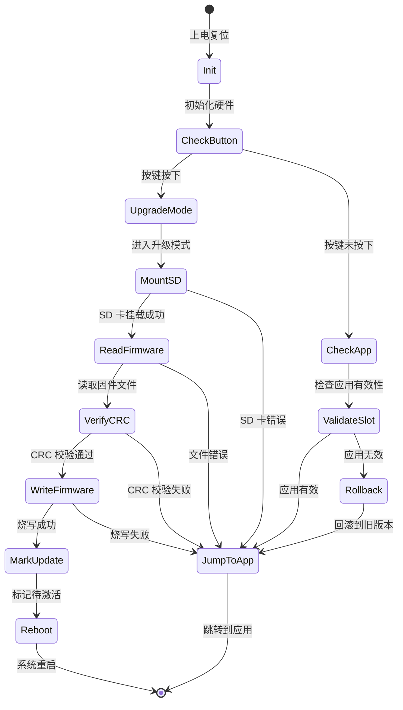
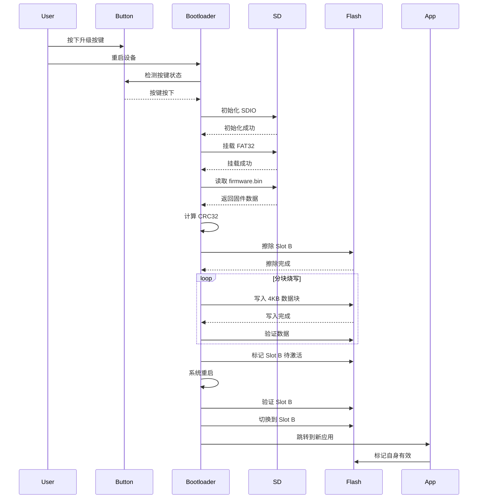
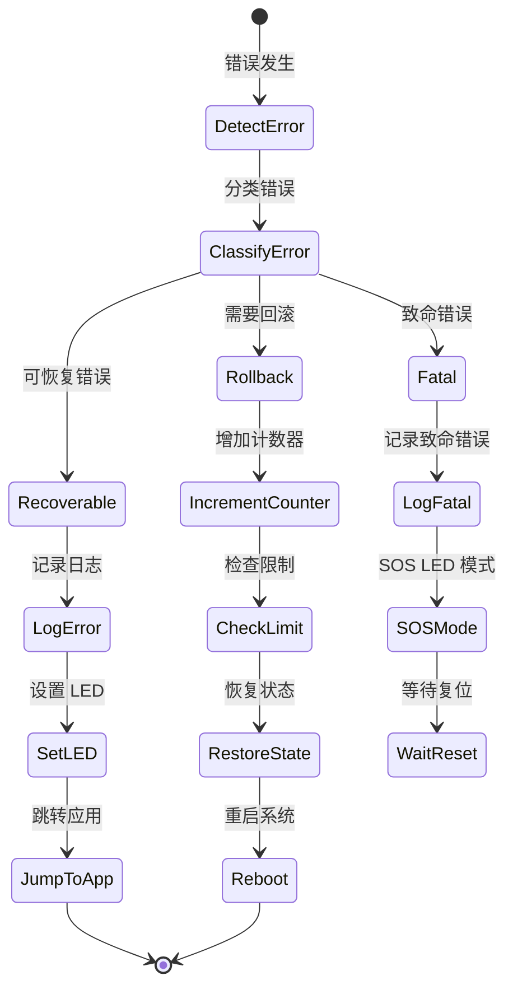

# STM32F407 SD 卡 Bootloader 升级系统设计文档

## 1. 概述

本设计文档描述了基于 embassy-boot 框架的 STM32F407 bootloader 系统的技术实现方案。系统采用双分区（A/B）架构，支持从 SD 卡读取固件并进行安全升级，具备完整的回滚机制和错误处理能力。

### 1.1 核心特性

- **双分区架构**：Active/Update 分区设计，支持原子切换
- **安全升级**：CRC32 完整性校验，防止损坏固件烧写
- **自动回滚**：升级失败时自动恢复到稳定版本
- **用户友好**：LED 状态指示，按键触发升级
- **高性能**：SDIO 4-bit 模式，快速固件传输

### 1.2 技术栈

- **框架**：embassy-boot 0.3.x（异步 bootloader 框架）
- **HAL**：embassy-stm32（STM32 硬件抽象层）
- **文件系统**：embedded-sdmmc-rs（FAT32 支持）
- **校验**：crc crate（CRC32 计算）
- **日志**：defmt（嵌入式日志系统）

## 2. 架构设计

### 2.1 系统架构

```
┌─────────────────────────────────────────────────────────┐
│                    STM32F407 Flash                       │
├─────────────────────────────────────────────────────────┤
│  Bootloader (64KB)                                       │
│  ┌───────────────────────────────────────────────────┐  │
│  │ - 启动检测（按键/状态）                            │  │
│  │ - SD 卡固件读取                                    │  │
│  │ - 固件校验（CRC32）                                │  │
│  │ - 固件烧写（Slot B）                               │  │
│  │ - 分区切换逻辑                                     │  │
│  │ - 应用跳转                                         │  │
│  └───────────────────────────────────────────────────┘  │
├─────────────────────────────────────────────────────────┤
│  Application Slot A (512KB) - Active                    │
│  ┌───────────────────────────────────────────────────┐  │
│  │ 当前运行的应用程序                                 │  │
│  └───────────────────────────────────────────────────┘  │
├─────────────────────────────────────────────────────────┤
│  Application Slot B (512KB) - Update                    │
│  ┌───────────────────────────────────────────────────┐  │
│  │ 升级目标分区                                       │  │
│  └───────────────────────────────────────────────────┘  │
├─────────────────────────────────────────────────────────┤
│  Boot State (64KB)                                       │
│  ┌───────────────────────────────────────────────────┐  │
│  │ embassy-boot 状态存储                              │  │
│  │ - 当前活动分区标记                                 │  │
│  │ - 升级状态标志                                     │  │
│  │ - 回滚计数器                                       │  │
│  └───────────────────────────────────────────────────┘  │
└─────────────────────────────────────────────────────────┘

┌─────────────────┐         ┌─────────────────┐
│   SD Card       │◄────────┤  SDIO Interface │
│  (FAT32)        │  4-bit  │  (PC8-PC12,PD2) │
│  firmware.bin   │         └─────────────────┘
└─────────────────┘

┌─────────────────┐         ┌─────────────────┐
│  Button (PE4)   │────────►│  Upgrade Trigger│
└─────────────────┘         └─────────────────┘

┌─────────────────┐         ┌─────────────────┐
│  LED1 (PA7)     │◄────────│  Status Display │
│  LED2 (PA6)     │         │  (Heartbeat)    │
└─────────────────┘         └─────────────────┘
```

### 2.2 状态机设计

Bootloader 运行状态机：



### 2.3 升级流程时序



## 3. 组件和接口

### 3.1 核心组件

#### 3.1.1 BootManager（启动管理器）

**职责**：
- 管理 bootloader 启动流程
- 协调各组件工作
- 决策升级或跳转

**接口**：
```rust
pub struct BootManager {
    flash: FlashManager,
    sd_reader: SdCardReader,
    button: ButtonInput,
    led: LedIndicator,
    state: BootState,
}

impl BootManager {
    /// 初始化 bootloader
    pub fn new() -> Self;
    
    /// 主运行循环
    pub async fn run(&mut self) -> !;
    
    /// 检查是否需要升级
    fn should_upgrade(&self) -> bool;
    
    /// 执行升级流程
    async fn perform_upgrade(&mut self) -> Result<(), UpgradeError>;
    
    /// 跳转到应用程序
    fn jump_to_app(&self) -> !;
}
```

#### 3.1.2 SdCardReader（SD 卡读取器）

**职责**：
- 初始化 SDIO 接口
- 挂载 FAT32 文件系统
- 读取固件文件

**接口**：
```rust
pub struct SdCardReader {
    sdio: Sdio<'static>,
    volume: Option<Volume>,
}

impl SdCardReader {
    /// 初始化 SD 卡
    pub async fn init() -> Result<Self, SdError>;
    
    /// 挂载文件系统
    pub async fn mount(&mut self) -> Result<(), SdError>;
    
    /// 打开固件文件
    pub async fn open_firmware(&mut self) -> Result<FirmwareFile, SdError>;
    
    /// 读取数据块
    pub async fn read_block(&mut self, buffer: &mut [u8]) -> Result<usize, SdError>;
}

pub struct FirmwareFile {
    file: File,
    size: u32,
}

impl FirmwareFile {
    /// 获取文件大小
    pub fn size(&self) -> u32;
    
    /// 读取数据
    pub async fn read(&mut self, buffer: &mut [u8]) -> Result<usize, SdError>;
}
```

#### 3.1.3 FlashManager（Flash 管理器）

**职责**：
- 管理 Flash 分区
- 执行擦除和写入操作
- 验证数据完整性

**接口**：
```rust
pub struct FlashManager {
    flash: Flash<'static>,
    config: FlashConfig,
}

pub struct FlashConfig {
    pub bootloader_start: u32,
    pub bootloader_size: u32,
    pub slot_a_start: u32,
    pub slot_a_size: u32,
    pub slot_b_start: u32,
    pub slot_b_size: u32,
    pub state_start: u32,
    pub state_size: u32,
}

impl FlashManager {
    /// 初始化 Flash 管理器
    pub fn new(flash: Flash<'static>) -> Self;
    
    /// 擦除分区
    pub async fn erase_slot(&mut self, slot: Slot) -> Result<(), FlashError>;
    
    /// 写入数据块
    pub async fn write_block(
        &mut self,
        slot: Slot,
        offset: u32,
        data: &[u8]
    ) -> Result<(), FlashError>;
    
    /// 验证数据
    pub async fn verify_block(
        &mut self,
        slot: Slot,
        offset: u32,
        expected: &[u8]
    ) -> Result<bool, FlashError>;
    
    /// 标记分区状态
    pub async fn mark_slot_pending(&mut self, slot: Slot) -> Result<(), FlashError>;
    
    /// 检查应用有效性
    pub fn is_app_valid(&self, slot: Slot) -> bool;
}

#[derive(Copy, Clone)]
pub enum Slot {
    A,
    B,
}
```

#### 3.1.4 FirmwareVerifier（固件校验器）

**职责**：
- 计算 CRC32 校验值
- 验证固件完整性
- 检查固件大小

**接口**：
```rust
pub struct FirmwareVerifier {
    crc: Crc<u32>,
}

impl FirmwareVerifier {
    /// 创建校验器
    pub fn new() -> Self;
    
    /// 更新 CRC 计算
    pub fn update(&mut self, data: &[u8]);
    
    /// 完成计算并返回 CRC 值
    pub fn finalize(&self) -> u32;
    
    /// 验证固件大小
    pub fn validate_size(&self, size: u32) -> Result<(), VerifyError>;
    
    /// 重置校验器
    pub fn reset(&mut self);
}
```

#### 3.1.5 LedIndicator（LED 指示器）

**职责**：
- 控制 LED 状态
- 显示升级进度
- 指示错误状态

**接口**：
```rust
pub struct LedIndicator {
    led1: Output<'static>,  // PA7 - 状态指示
    led2: Output<'static>,  // PA6 - 心跳指示
}

#[derive(Copy, Clone)]
pub enum LedPattern {
    Off,
    On,
    FastBlink,      // 100ms
    MediumBlink,    // 200ms
    SlowBlink,      // 500ms
}

impl LedIndicator {
    /// 初始化 LED
    pub fn new(led1: Output<'static>, led2: Output<'static>) -> Self;
    
    /// 设置状态 LED 模式
    pub fn set_status(&mut self, pattern: LedPattern);
    
    /// 设置心跳 LED
    pub fn set_heartbeat(&mut self, enabled: bool);
    
    /// 更新 LED 状态（在主循环中调用）
    pub async fn update(&mut self);
}
```

#### 3.1.6 ButtonInput（按键输入）

**职责**：
- 读取按键状态
- 软件消抖
- 提供按键事件

**接口**：
```rust
pub struct ButtonInput {
    pin: Input<'static>,
    debounce_time: Duration,
}

impl ButtonInput {
    /// 初始化按键
    pub fn new(pin: Input<'static>) -> Self;
    
    /// 检查按键是否按下（带消抖）
    pub async fn is_pressed(&mut self) -> bool;
    
    /// 等待按键释放
    pub async fn wait_release(&mut self);
}
```

### 3.2 组件交互

```
BootManager
    ├── ButtonInput (检测升级触发)
    ├── LedIndicator (状态显示)
    ├── SdCardReader (读取固件)
    │   └── FirmwareFile
    ├── FlashManager (烧写固件)
    └── FirmwareVerifier (校验固件)
```

## 4. 数据模型

### 4.1 Flash 分区布局

```rust
/// Flash 分区配置
pub const FLASH_CONFIG: FlashConfig = FlashConfig {
    bootloader_start: 0x0800_0000,
    bootloader_size: 64 * 1024,      // 64KB
    
    slot_a_start: 0x0801_0000,
    slot_a_size: 512 * 1024,         // 512KB
    
    slot_b_start: 0x0809_0000,
    slot_b_size: 512 * 1024,         // 512KB
    
    state_start: 0x0811_0000,
    state_size: 64 * 1024,           // 64KB
};
```

### 4.2 Boot 状态数据

```rust
/// embassy-boot 状态结构
#[repr(C)]
pub struct BootState {
    /// 魔数标识（0x424F4F54 = "BOOT"）
    magic: u32,
    
    /// 当前活动分区（0=Slot A, 1=Slot B）
    active_slot: u8,
    
    /// 待激活分区（0xFF=无，0=Slot A, 1=Slot B）
    pending_slot: u8,
    
    /// 回滚计数器（最多尝试 3 次）
    rollback_count: u8,
    
    /// 状态标志
    flags: u8,
    
    /// CRC32 校验值
    crc: u32,
}

impl BootState {
    pub const MAGIC: u32 = 0x424F4F54;
    pub const MAX_ROLLBACK: u8 = 3;
    
    /// 创建默认状态
    pub fn default() -> Self;
    
    /// 从 Flash 读取状态
    pub fn load(flash: &Flash) -> Result<Self, StateError>;
    
    /// 保存状态到 Flash
    pub fn save(&self, flash: &mut Flash) -> Result<(), StateError>;
    
    /// 标记分区待激活
    pub fn mark_pending(&mut self, slot: Slot);
    
    /// 确认分区激活
    pub fn confirm_active(&mut self, slot: Slot);
    
    /// 增加回滚计数
    pub fn increment_rollback(&mut self);
    
    /// 重置回滚计数
    pub fn reset_rollback(&mut self);
    
    /// 检查是否需要回滚
    pub fn should_rollback(&self) -> bool;
}
```

### 4.3 固件元数据

```rust
/// 固件文件信息
pub struct FirmwareMetadata {
    /// 文件大小（字节）
    pub size: u32,
    
    /// CRC32 校验值
    pub crc32: u32,
    
    /// 版本号（可选，从文件名解析）
    pub version: Option<Version>,
}

#[derive(Debug, Clone, Copy)]
pub struct Version {
    pub major: u8,
    pub minor: u8,
    pub patch: u8,
}

impl FirmwareMetadata {
    /// 从文件创建元数据
    pub fn from_file(file: &FirmwareFile) -> Self;
    
    /// 验证元数据有效性
    pub fn validate(&self) -> Result<(), MetadataError>;
}
```

### 4.4 错误类型

```rust
/// 升级错误类型
#[derive(Debug)]
pub enum UpgradeError {
    /// SD 卡相关错误
    SdCard(SdError),
    
    /// Flash 操作错误
    Flash(FlashError),
    
    /// 固件校验错误
    Verification(VerifyError),
    
    /// 超时错误
    Timeout,
    
    /// 状态错误
    State(StateError),
}

#[derive(Debug)]
pub enum SdError {
    InitFailed,
    MountFailed,
    FileNotFound,
    ReadError,
    Timeout,
}

#[derive(Debug)]
pub enum FlashError {
    EraseFailed,
    WriteFailed,
    VerifyFailed,
    InvalidAddress,
}

#[derive(Debug)]
pub enum VerifyError {
    SizeTooLarge,
    CrcMismatch,
    InvalidFormat,
}

#[derive(Debug)]
pub enum StateError {
    InvalidMagic,
    CrcMismatch,
    ReadFailed,
    WriteFailed,
}
```

### 4.5 配置常量

```rust
/// 系统配置常量
pub mod config {
    use core::time::Duration;
    
    /// 固件文件名
    pub const FIRMWARE_FILENAME: &str = "firmware.bin";
    
    /// 最大固件大小
    pub const MAX_FIRMWARE_SIZE: u32 = 512 * 1024;
    
    /// Flash 写入块大小
    pub const FLASH_BLOCK_SIZE: usize = 4096;
    
    /// SD 卡读取缓冲区大小
    pub const SD_BUFFER_SIZE: usize = 4096;
    
    /// 超时配置
    pub const SD_INIT_TIMEOUT: Duration = Duration::from_secs(5);
    pub const SD_READ_TIMEOUT: Duration = Duration::from_secs(30);
    pub const FLASH_WRITE_TIMEOUT: Duration = Duration::from_secs(60);
    
    /// 按键消抖时间
    pub const BUTTON_DEBOUNCE_MS: u64 = 20;
    
    /// 按键检测窗口
    pub const BUTTON_CHECK_WINDOW_MS: u64 = 2000;
    
    /// LED 闪烁周期
    pub const LED_FAST_BLINK_MS: u64 = 100;
    pub const LED_MEDIUM_BLINK_MS: u64 = 200;
    pub const LED_SLOW_BLINK_MS: u64 = 500;
}
```


## 5. 正确性属性

*属性（Property）是系统在所有有效执行中都应该保持为真的特征或行为——本质上是关于系统应该做什么的形式化陈述。属性是人类可读规范和机器可验证正确性保证之间的桥梁。*

### 5.1 数据完整性属性

**Property 1: CRC32 校验一致性**

*对于任何* 固件数据块，如果计算的 CRC32 值与预期值不匹配，系统应该拒绝该固件并保持当前版本不变

**验证：需求 2.2.1**

**Property 2: Flash 写入验证**

*对于任何* 写入 Flash 的数据块，读回的数据应该与写入的数据完全一致

**验证：需求 3.4.3**

**Property 3: 分区地址不重叠**

*对于任何* 两个不同的 Flash 分区，它们的地址范围不应该有任何重叠

**验证：需求 3.2.1**

### 5.2 状态管理属性

**Property 4: 回滚计数器限制**

*对于任何* 启动失败场景，回滚计数器增加后，如果达到最大值（3 次），系统应该永久回滚到稳定版本

**验证：需求 3.4.5**

**Property 5: 升级失败回滚**

*对于任何* 升级失败情况（CRC 错误、烧写错误、超时），系统应该保持或回滚到之前的稳定版本

**验证：需求 2.2.3**


### 5.3 错误处理属性

**Property 6: 固件大小验证**

*对于任何* 大于 512KB 的固件文件，系统应该拒绝升级并返回错误

**验证：需求 3.3.2**

**Property 7: SD 卡错误恢复**

*对于任何* SD 卡错误（未插入、挂载失败、文件不存在），系统应该跳转到现有应用程序而不是挂起

**验证：需求 3.5.1**

**Property 8: 固件错误处理**

*对于任何* 固件相关错误（CRC 失败、烧写失败），系统应该设置错误 LED 状态并保持当前版本运行

**验证：需求 3.5.2**

### 5.4 用户交互属性

**Property 9: LED 状态映射**

*对于任何* 系统状态（读取中、烧写中、成功、失败），LED 应该显示对应的正确模式

**验证：需求 2.3.1**


## 6. 错误处理

### 6.1 错误分类

系统错误分为以下几类，每类有不同的处理策略：

#### 6.1.1 可恢复错误

这些错误不影响系统稳定性，可以继续运行：

- **SD 卡未插入**：跳过升级，直接启动应用
- **固件文件不存在**：跳过升级，直接启动应用
- **固件 CRC 校验失败**：拒绝升级，保持当前版本
- **固件大小超限**：拒绝升级，保持当前版本

**处理策略**：
1. 记录错误日志（defmt）
2. 设置 LED 错误指示（快速闪烁 3 秒）
3. 跳转到当前应用程序

#### 6.1.2 需要回滚的错误

这些错误发生在升级过程中，需要回滚：

- **Flash 擦除失败**：回滚到旧版本
- **Flash 写入失败**：回滚到旧版本
- **写入验证失败**：回滚到旧版本
- **新应用启动失败**：自动回滚（最多 3 次）

**处理策略**：
1. 记录错误日志和错误代码
2. 增加回滚计数器
3. 恢复 Boot State 到稳定状态
4. 标记旧分区为活动分区
5. 重启系统

#### 6.1.3 致命错误

这些错误表示硬件或系统严重问题：

- **Flash 硬件故障**：无法读写
- **Boot State 损坏**：无法恢复状态
- **所有分区都无效**：无可用应用

**处理策略**：
1. 记录致命错误日志
2. LED 持续快速闪烁（SOS 模式）
3. 进入无限循环等待看门狗复位或手动干预

### 6.2 超时处理

所有 I/O 操作都有超时保护：

```rust
/// 超时处理示例
async fn read_with_timeout<T>(
    operation: impl Future<Output = Result<T, Error>>,
    timeout: Duration
) -> Result<T, UpgradeError> {
    match embassy_time::with_timeout(timeout, operation).await {
        Ok(Ok(result)) => Ok(result),
        Ok(Err(e)) => Err(UpgradeError::from(e)),
        Err(_) => Err(UpgradeError::Timeout),
    }
}
```

**超时配置**：
- SD 卡初始化：5 秒
- 文件读取：30 秒
- Flash 烧写：60 秒

**超时后行为**：
- 记录超时错误
- 取消当前操作
- 执行对应错误处理策略

### 6.3 错误码定义

```rust
/// 错误码枚举
#[repr(u8)]
pub enum ErrorCode {
    // SD 卡错误 (0x10-0x1F)
    SdInitFailed = 0x10,
    SdMountFailed = 0x11,
    SdFileNotFound = 0x12,
    SdReadError = 0x13,
    SdTimeout = 0x14,
    
    // Flash 错误 (0x20-0x2F)
    FlashEraseFailed = 0x20,
    FlashWriteFailed = 0x21,
    FlashVerifyFailed = 0x22,
    FlashInvalidAddress = 0x23,
    
    // 固件错误 (0x30-0x3F)
    FirmwareTooLarge = 0x30,
    FirmwareCrcMismatch = 0x31,
    FirmwareInvalidFormat = 0x32,
    
    // 状态错误 (0x40-0x4F)
    StateInvalidMagic = 0x40,
    StateCrcMismatch = 0x41,
    StateReadFailed = 0x42,
    StateWriteFailed = 0x43,
    
    // 超时错误 (0x50-0x5F)
    TimeoutGeneral = 0x50,
}

impl ErrorCode {
    /// 获取错误描述
    pub fn description(&self) -> &'static str {
        match self {
            Self::SdInitFailed => "SD card initialization failed",
            Self::SdMountFailed => "Failed to mount FAT32 filesystem",
            // ... 其他错误描述
            _ => "Unknown error",
        }
    }
    
    /// 判断是否为致命错误
    pub fn is_fatal(&self) -> bool {
        matches!(self,
            Self::FlashEraseFailed |
            Self::StateReadFailed |
            Self::StateWriteFailed
        )
    }
}
```

### 6.4 错误恢复流程




## 7. 测试策略

### 7.1 测试方法

本项目采用**双重测试方法**：

- **单元测试**：验证特定示例、边界情况和错误条件
- **属性测试**：验证所有输入下的通用属性

两者互补，共同确保全面覆盖：
- 单元测试捕获具体的 bug
- 属性测试验证通用正确性

### 7.2 属性测试配置

**测试库选择**：使用 `proptest` crate（Rust 的属性测试库）

**配置要求**：
- 每个属性测试最少运行 **100 次迭代**（由于随机化）
- 每个测试必须引用设计文档中的属性
- 标签格式：`Feature: stm32-sd-bootloader, Property {number}: {property_text}`

**示例配置**：
```rust
use proptest::prelude::*;

proptest! {
    #![proptest_config(ProptestConfig::with_cases(100))]
    
    /// Feature: stm32-sd-bootloader, Property 1: CRC32 校验一致性
    #[test]
    fn test_crc_verification(data in prop::collection::vec(any::<u8>(), 0..1024)) {
        let mut verifier = FirmwareVerifier::new();
        verifier.update(&data);
        let crc1 = verifier.finalize();
        
        verifier.reset();
        verifier.update(&data);
        let crc2 = verifier.finalize();
        
        prop_assert_eq!(crc1, crc2);
    }
}
```

### 7.3 测试覆盖范围

#### 7.3.1 属性测试（Property-Based Tests）

基于第 5 节的正确性属性：

1. **Property 1: CRC32 校验一致性**
   - 生成随机固件数据
   - 验证 CRC 计算的确定性和一致性
   - 验证 CRC 不匹配时拒绝固件

2. **Property 2: Flash 写入验证**
   - 生成随机数据块
   - 写入后读回验证
   - 确保数据完整性

3. **Property 3: 分区地址不重叠**
   - 验证所有分区配置
   - 确保地址范围不冲突

4. **Property 4: 回滚计数器限制**
   - 模拟多次启动失败
   - 验证计数器正确递增
   - 验证达到限制后的行为

5. **Property 5: 升级失败回滚**
   - 模拟各种失败场景
   - 验证系统状态正确恢复

6. **Property 6: 固件大小验证**
   - 生成不同大小的固件
   - 验证超限拒绝逻辑

7. **Property 7: SD 卡错误恢复**
   - 模拟各种 SD 卡错误
   - 验证系统不挂起

8. **Property 8: 固件错误处理**
   - 模拟固件错误
   - 验证错误处理流程

9. **Property 9: LED 状态映射**
   - 遍历所有系统状态
   - 验证 LED 模式正确

#### 7.3.2 单元测试（Unit Tests）

针对具体功能和边界情况：

1. **BootManager 测试**
   - 按键检测逻辑
   - 启动流程决策
   - 应用跳转

2. **SdCardReader 测试**
   - SDIO 初始化
   - FAT32 挂载
   - 文件查找和读取
   - 错误处理

3. **FlashManager 测试**
   - 分区擦除
   - 数据写入
   - 数据验证
   - 边界地址处理

4. **FirmwareVerifier 测试**
   - CRC32 计算
   - 大小验证
   - 边界情况（空文件、最大文件）

5. **BootState 测试**
   - 状态加载和保存
   - 状态切换逻辑
   - CRC 校验
   - 回滚计数

6. **LedIndicator 测试**
   - LED 模式设置
   - 闪烁时序
   - 状态转换

7. **ButtonInput 测试**
   - 消抖逻辑
   - 按键状态读取
   - 边界情况（长按、短按）

#### 7.3.3 集成测试（Integration Tests）

测试组件协作：

1. **完整升级流程**
   - 从按键触发到应用启动
   - 验证所有组件正确协作

2. **错误恢复流程**
   - 模拟各阶段错误
   - 验证系统正确恢复

3. **回滚流程**
   - 模拟应用启动失败
   - 验证自动回滚

### 7.4 测试环境

#### 7.4.1 单元测试环境

- **平台**：主机（x86_64）
- **工具**：`cargo test`
- **模拟**：使用 mock 对象模拟硬件接口

#### 7.4.2 集成测试环境

- **平台**：QEMU STM32 模拟器或实际硬件
- **工具**：`probe-rs`、`defmt-test`
- **硬件**：STM32F407 开发板 + SD 卡模块

### 7.5 测试数据生成

使用 `proptest` 生成测试数据：

```rust
/// 固件数据生成器
fn firmware_data() -> impl Strategy<Value = Vec<u8>> {
    prop::collection::vec(any::<u8>(), 0..MAX_FIRMWARE_SIZE as usize)
}

/// 有效固件生成器（≤512KB）
fn valid_firmware() -> impl Strategy<Value = Vec<u8>> {
    prop::collection::vec(any::<u8>(), 0..=512 * 1024)
}

/// 无效固件生成器（>512KB）
fn invalid_firmware() -> impl Strategy<Value = Vec<u8>> {
    prop::collection::vec(any::<u8>(), 512 * 1024 + 1..1024 * 1024)
}

/// Flash 地址生成器
fn flash_address() -> impl Strategy<Value = u32> {
    0x0800_0000u32..0x0810_0000u32
}

/// 错误类型生成器
fn error_type() -> impl Strategy<Value = UpgradeError> {
    prop_oneof![
        Just(UpgradeError::SdCard(SdError::InitFailed)),
        Just(UpgradeError::Flash(FlashError::EraseFailed)),
        Just(UpgradeError::Verification(VerifyError::CrcMismatch)),
        Just(UpgradeError::Timeout),
    ]
}
```

### 7.6 持续集成

**CI 流程**：
1. 代码提交触发 CI
2. 运行所有单元测试
3. 运行属性测试（100 次迭代）
4. 代码覆盖率检查（目标 >80%）
5. 静态分析（clippy）
6. 格式检查（rustfmt）

**硬件在环测试（HIL）**：
- 定期在实际硬件上运行完整测试套件
- 验证 QEMU 模拟器无法覆盖的硬件特性

### 7.7 测试优先级

**P0（关键）**：
- CRC 校验
- Flash 写入验证
- 回滚机制
- 错误处理

**P1（重要）**：
- SD 卡读取
- 状态管理
- LED 指示
- 按键检测

**P2（次要）**：
- 性能测试
- 边界情况
- 日志输出

## 8. 实现注意事项

### 8.1 内存管理

- **栈大小**：bootloader 栈设置为 8KB
- **堆分配**：避免动态内存分配，使用静态缓冲区
- **缓冲区**：SD 读取和 Flash 写入共享 4KB 缓冲区

### 8.2 性能优化

- **SDIO 时钟**：初始化时使用低速（400kHz），传输时切换到高速（25MHz）
- **Flash 写入**：使用 DMA 加速（如果可用）
- **并行操作**：读取下一块数据时验证当前块

### 8.3 安全考虑

- **向量表重定位**：跳转前正确设置 VTOR 寄存器
- **中断禁用**：跳转前禁用所有中断
- **看门狗**：升级过程中定期喂狗
- **掉电保护**：使用 embassy-boot 的原子状态切换

### 8.4 调试支持

- **RTT 日志**：详细的 defmt 日志输出
- **错误码**：每个错误点输出唯一错误码
- **状态转储**：关键点输出系统状态
- **LED 诊断**：通过 LED 闪烁模式快速诊断问题

### 8.5 兼容性

- **embassy-boot 版本**：锁定到 0.3.x，避免破坏性更新
- **Flash 布局**：预留扩展空间，便于未来升级
- **固件格式**：保持简单的 .bin 格式，便于工具生成

## 9. 部署和维护

### 9.1 初始部署

1. 使用 probe-rs 烧写 bootloader 到 0x08000000
2. 烧写初始应用到 Slot A (0x08010000)
3. 初始化 Boot State 区域
4. 验证系统启动

### 9.2 固件制作

```bash
# 编译应用程序
cargo build --release

# 生成 .bin 文件
arm-none-eabi-objcopy -O binary \
    target/thumbv7em-none-eabihf/release/app \
    firmware.bin

# 计算 CRC32（可选）
crc32 firmware.bin > firmware.crc

# 复制到 SD 卡
cp firmware.bin /media/sdcard/
```

### 9.3 升级流程

1. 将 firmware.bin 复制到 SD 卡根目录
2. 插入 SD 卡到设备
3. 按住升级按键（PE4）
4. 重启设备
5. 观察 LED 状态
6. 等待升级完成（LED 常亮）
7. 释放按键
8. 设备自动重启进入新应用

### 9.4 故障排查

| 现象 | 可能原因 | 解决方法 |
|------|---------|---------|
| LED 快速闪烁 | SD 卡错误或固件错误 | 检查 SD 卡和固件文件 |
| 升级后无法启动 | 固件不兼容 | 系统会自动回滚，检查固件 |
| 升级时间过长 | SD 卡速度慢 | 更换高速 SD 卡 |
| 无法进入升级模式 | 按键未检测到 | 检查按键连接和时序 |

### 9.5 版本管理

- **Bootloader 版本**：在代码中定义版本号
- **应用版本**：应用程序应包含版本信息
- **兼容性矩阵**：维护 bootloader 和应用的兼容性表

## 10. 参考实现

### 10.1 主函数结构

```rust
#![no_std]
#![no_main]

use embassy_executor::Spawner;
use embassy_stm32::Config;
use defmt_rtt as _;
use panic_probe as _;

#[embassy_executor::main]
async fn main(_spawner: Spawner) {
    defmt::info!("STM32F407 Bootloader v1.0.0");
    
    // 初始化硬件
    let p = embassy_stm32::init(Default::default());
    
    // 创建 BootManager
    let mut boot_manager = BootManager::new(p);
    
    // 运行 bootloader
    boot_manager.run().await;
}
```

### 10.2 关键算法伪代码

**升级流程**：
```
function perform_upgrade():
    led.set_status(MediumBlink)  // 读取中
    
    // 1. 初始化 SD 卡
    sd = SdCardReader::init() or return Error
    sd.mount() or return Error
    
    // 2. 打开固件文件
    file = sd.open_firmware() or return Error
    
    // 3. 验证大小
    if file.size() > MAX_SIZE:
        return Error
    
    // 4. 计算 CRC
    verifier = FirmwareVerifier::new()
    while data = file.read():
        verifier.update(data)
    crc = verifier.finalize()
    
    // 5. 擦除目标分区
    led.set_status(SlowBlink)  // 烧写中
    flash.erase_slot(Slot::B) or return Error
    
    // 6. 烧写固件
    file.seek(0)
    offset = 0
    while data = file.read():
        flash.write_block(Slot::B, offset, data) or return Error
        flash.verify_block(Slot::B, offset, data) or return Error
        offset += data.len()
    
    // 7. 标记待激活
    flash.mark_slot_pending(Slot::B) or return Error
    
    // 8. 成功
    led.set_status(On)
    delay(2000)
    system_reset()
```

**回滚流程**：
```
function check_and_rollback():
    state = BootState::load()
    
    if state.should_rollback():
        defmt::warn!("Application failed to start, rolling back")
        
        // 切换回旧分区
        state.active_slot = previous_slot
        state.increment_rollback()
        state.save()
        
        if state.rollback_count >= MAX_ROLLBACK:
            defmt::error!("Max rollback attempts reached")
            state.reset_rollback()
            state.save()
        
        system_reset()
```

## 11. 总结

本设计文档详细描述了基于 embassy-boot 的 STM32F407 SD 卡 bootloader 升级系统的技术实现方案。系统采用双分区架构，具备完整的安全机制和错误处理能力，能够可靠地从 SD 卡升级固件并在失败时自动回滚。

**关键设计决策**：
1. 使用 embassy-boot 框架简化 bootloader 开发
2. 双分区设计确保升级安全性
3. CRC32 校验保证固件完整性
4. 自动回滚机制防止设备变砖
5. 清晰的错误处理和状态指示

**下一步**：
- 创建详细的任务列表（tasks.md）
- 开始实现核心组件
- 建立测试环境
- 编写单元测试和属性测试
